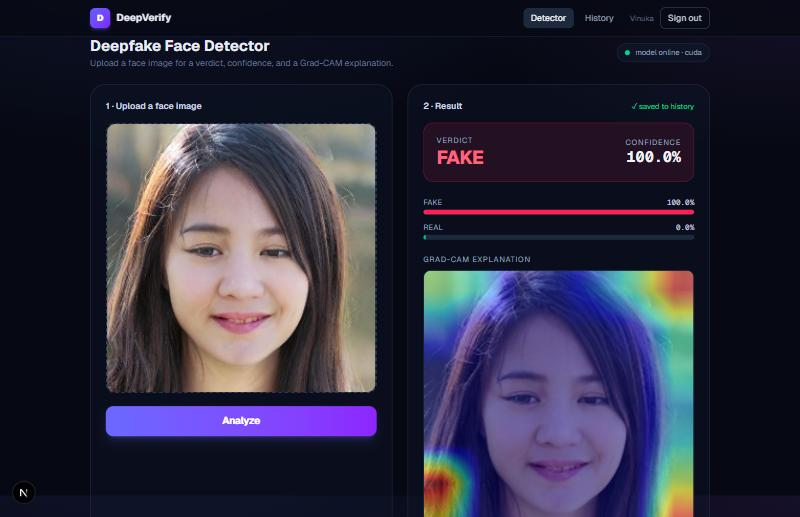
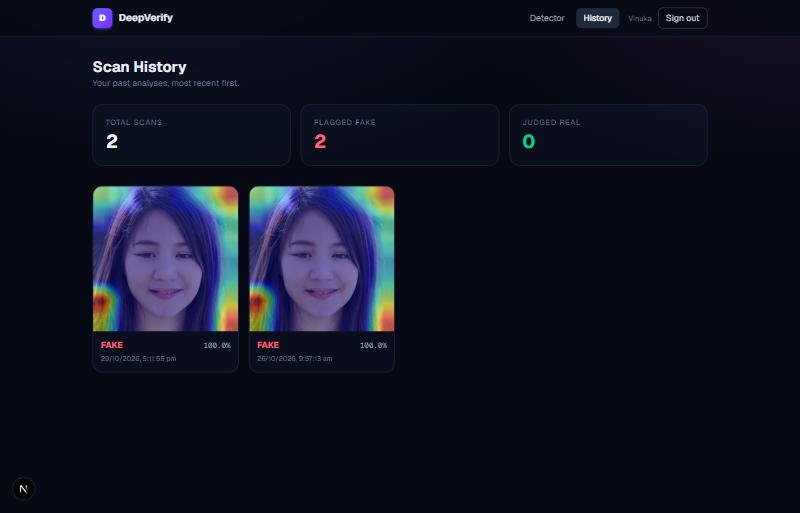
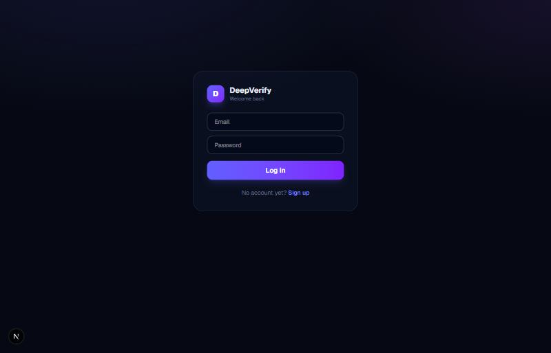
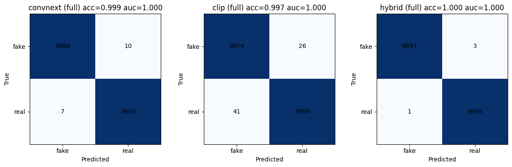
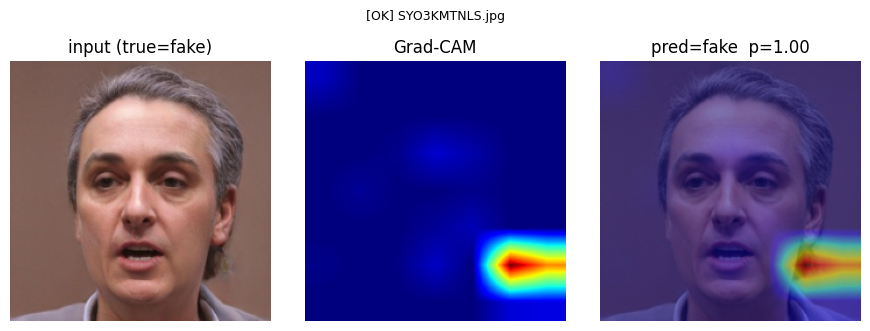
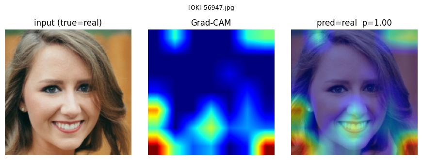
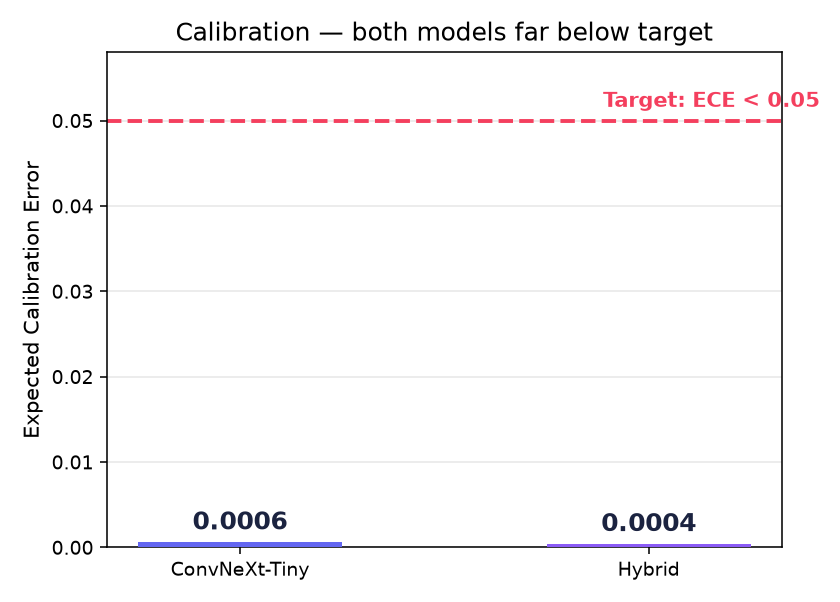
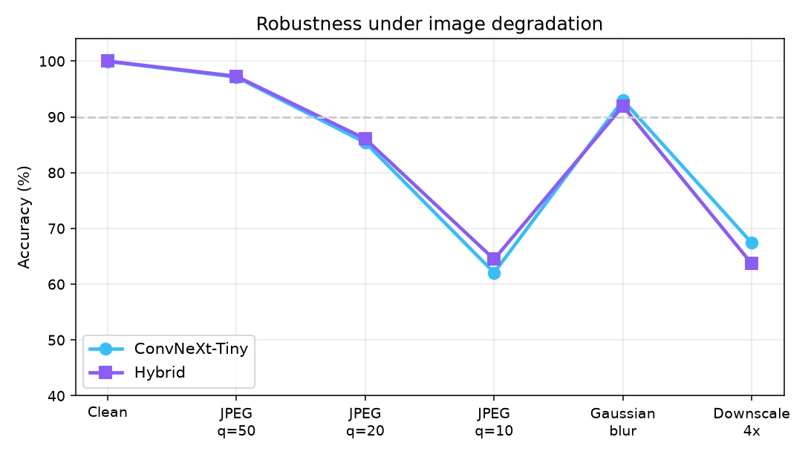
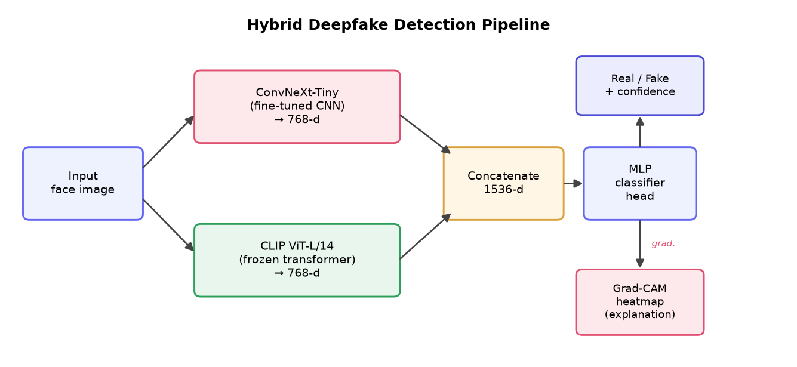

<div align="center">

# 🛡️ DeepVerify — AI-Powered Deepfake Image Detection

**A hybrid CNN–Transformer detector that tells you if a face is real or AI-generated — and _shows you why_.**

[](https://www.python.org/)
[](https://pytorch.org/)
[](https://fastapi.tiangolo.com/)
[](https://nextjs.org/)
[](https://www.typescriptlang.org/)
[](LICENSE)

</div>

---

DeepVerify fuses a **ConvNeXt-Tiny** convolutional network (sensitive to local pixel artefacts) with a **frozen CLIP ViT-L/14** vision-language transformer (sensitive to global semantics). Every verdict ships with a **confidence score** and a **Grad-CAM heatmap**, so a non-expert can see *where* the model looked — turning a black-box label into an inspectable decision.

Built as the MSE907 Master of Software Engineering capstone, it is delivered as a **full-stack web platform**: a FastAPI model server and a Next.js dashboard with accounts and per-user scan history.

<p align="center">
  
</p>

---

## ✨ Features

- 🧠 **Hybrid detection model** — ConvNeXt-Tiny + frozen CLIP ViT-L/14, fused into a lightweight MLP head (**99.98 %** test accuracy).
- 🔍 **Explainable verdicts** — Grad-CAM heatmap overlaid on every prediction.
- 📊 **Trustworthy confidence** — calibrated scores (Expected Calibration Error **0.0004**, far below the 0.05 target).
- 🖥️ **Full web platform** — drag-and-drop detector, verdict + confidence + heatmap in ~0.1 s/image (GPU).
- 🔐 **Accounts & history** — secure signup/login (signed-JWT cookie + bcrypt) and a private per-user scan history with stats.
- 🧩 **Decoupled architecture** — Python model server and TypeScript frontend communicate over a documented HTTP/JSON API.

---

## 🖼️ Screenshots

| Detector | Scan history | Sign in |
|:---:|:---:|:---:|
|  |  |  |
| Upload → verdict + confidence + Grad-CAM | Per-user history & real/fake stats | Authenticated access |

---

## 📈 Results

All three models were trained and evaluated under an identical protocol on the **140k Real and Fake Faces** dataset (100k train / 20k val / 20k test, balanced). The hybrid model wins on accuracy **and** has the lowest false-negative rate (the costliest error in verification).

| Model | Accuracy | AUC-ROC | F1 | False-negative rate |
|---|:---:|:---:|:---:|:---:|
| ConvNeXt-Tiny (CNN) | 0.9991 | 1.000 | 0.9991 | 0.0010 |
| CLIP ViT-L/14 + head | 0.9967 | 0.9998 | 0.9967 | 0.0026 |
| **Hybrid (fusion)** | **0.9998** | **1.000** | **0.9998** | **0.0003** |

> Success targets (accuracy ≥ 0.90, F1 ≥ 0.90, AUC ≥ 0.95, ECE < 0.05) — **all exceeded.** The hybrid misclassifies only **4 of 20,000** test images.

**Confusion matrices** — errors are rare and balanced across both classes:

<p align="center"></p>

**Explainability (Grad-CAM)** — heatmaps focus on coherent facial regions, not background:

<p align="center">
  
  
</p>

**Calibration & robustness** — confidence is reliable (left); accuracy under real-world image degradation, where the hybrid is consistently more robust to compression (right):

<p align="center">
  
  
</p>

---

## 🏗️ Architecture

**Detection pipeline** — two parallel branches (768-d each) fuse into a 1,536-d representation; Grad-CAM is computed from the CNN branch:

<p align="center"></p>

**Delivery platform** — a decoupled client–server design keeps the compute-heavy model independent of the UI:

```
┌──────────────────────────┐      HTTP/JSON      ┌──────────────────────────┐
│  Next.js frontend (:3000) │  ───────────────▶   │  FastAPI backend (:8000) │
│  • auth (signup/login)    │   image ─▶          │  • hybrid model          │
│  • detector dashboard     │   ◀── verdict +     │    (ConvNeXt + CLIP)      │
│  • scan history + stats   │       Grad-CAM      │  • Grad-CAM               │
│  • SQLite (node:sqlite)   │                     │  • /predict, /health     │
└──────────────────────────┘                     └──────────────────────────┘
```

---

## 🧰 Tech stack

| Layer | Technologies |
|---|---|
| **Model** | Python, PyTorch, `timm` (ConvNeXt-Tiny), Hugging Face Transformers (CLIP ViT-L/14), scikit-learn, matplotlib |
| **Explainability** | Grad-CAM (custom PyTorch hooks on the CNN branch) |
| **Backend** | FastAPI, Uvicorn |
| **Frontend** | Next.js (App Router), React, TypeScript, Tailwind CSS |
| **Auth & data** | `jose` signed-JWT cookie, bcrypt, Node built-in `node:sqlite` |
| **Training** | Google Colab (NVIDIA T4), local NVIDIA RTX 3050 |

---

## 📁 Repository structure

```
.
├── Deepfake_Baselines_Colab.ipynb   # Model training: baselines, hybrid, Grad-CAM, ECE, robustness
├── backend/                         # FastAPI model server
│   ├── main.py                      #   /predict + /health endpoints
│   ├── model.py                     #   HybridDetector (ConvNeXt + CLIP + fusion head + Grad-CAM)
│   ├── requirements.txt
│   └── export/                      #   Exported weights (Git LFS): convnext_tiny.pt, hybrid_head.pt, model_config.json
├── frontend/                        # Next.js dashboard
│   └── src/
│       ├── app/                     #   pages + API routes (signup/login/logout/scans)
│       ├── components/              #   Dropzone, ResultPanel, Nav, AuthForm
│       └── lib/                     #   api.ts, auth.ts, db.ts
├── sample_images/                   # Demo real/fake faces
└── docs/images/                     # Screenshots & result figures
```

> **Note:** `convnext_tiny.pt` (107 MB) and `hybrid_head.pt` are stored with **[Git LFS](https://git-lfs.com/)**. Install LFS (`git lfs install`) before cloning so the weights download correctly.

---

## 🚀 Getting started

### Prerequisites
- **Python 3.12** with PyTorch (CUDA recommended), `timm`, `transformers` — see `backend/requirements.txt`. CLIP ViT-L/14 (~1.7 GB) downloads from Hugging Face on first run.
- **Node.js 20+** (developed on Node 26) and npm.
- **Git LFS** — so the model weights in `backend/export/` are present.

### 1. Clone (with LFS)
```bash
git lfs install
git clone https://github.com/Vinuxbro/ai-deepfake-detection-platform.git
cd ai-deepfake-detection-platform
```

### 2. Backend — model server
```bash
pip install -r backend/requirements.txt
python -m uvicorn main:app --app-dir backend --port 8000
```
Wait for `Model ready.` (CLIP loads on startup).

### 3. Frontend — dashboard
```bash
cd frontend
cp .env.example .env.local        # then set AUTH_SECRET (see below)
npm install                       # first time only
npm run dev
```
Open **http://localhost:3000**, sign up, and start analysing images.

### Environment variables (`frontend/.env.local`)

| Variable | Purpose | Default |
|---|---|---|
| `NEXT_PUBLIC_API_URL` | URL of the FastAPI backend | `http://localhost:8000` |
| `AUTH_SECRET` | Secret for signing session JWTs | *(set a strong value)* |

Generate a secret:
```bash
node -e "console.log(require('crypto').randomBytes(32).toString('hex'))"
```

### Production build
```bash
cd frontend
npm run build && npm run start
```

---

## 🔬 Reproducing the models

The full training workflow lives in **[`Deepfake_Baselines_Colab.ipynb`](Deepfake_Baselines_Colab.ipynb)** — open it in Google Colab. It downloads the dataset, trains the ConvNeXt-Tiny and frozen-CLIP baselines, trains the hybrid fusion head, and runs Grad-CAM, ECE calibration, and the robustness study. The final cell exports the slim weights used by the backend (`backend/export/`).

---

## ⚖️ Limitations & responsible use

The model is trained on real FFHQ-style photos vs. **StyleGAN** fakes, so it is most reliable on that distribution and may not generalise to other generators (diffusion, face-swap). Accuracy also drops under heavy compression/downscaling (see the robustness chart). **Verdicts are advisory** and are always paired with a confidence score and a Grad-CAM explanation. Face images are sensitive biometric data: the platform processes images in memory, stores minimal data behind authentication, and sends nothing to third-party services.

---

## 📄 License

Released under the [MIT License](LICENSE).

## 🙏 Acknowledgements

MSE907 Industry-based Capstone Research Project, Master of Software Engineering (Level 9), **Yoobee College of Creative Innovation**. Built on the shoulders of ConvNeXt (Liu et al., 2022), CLIP (Radford et al., 2021), and Grad-CAM (Selvaraju et al., 2017).
